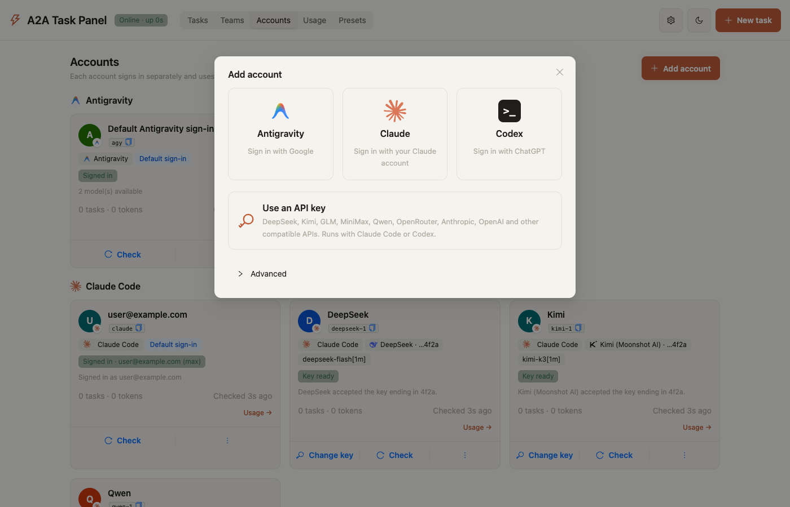

# a2a-panel

Delegate coding work from **Claude Code** to a team of **Google Antigravity** (`agy`) specialists, and watch and control it from a web panel.

Claude Code stays the team leader: it plans, splits the work and reviews the result. The heavy reading, editing and test running happens in Antigravity, so it uses your Antigravity quota instead of your Claude context. Claude reads back a short result: status, token usage, a `git` change summary and the tail of the output.

- **13 specialist roles** that follow the software lifecycle: `solution-architect` (requirements and design), `web-engineer`, `api-engineer`, `mobile-engineer`, `desktop-engineer`, `lead-software-engineer`, `test-engineer`, `bug-triager`, `code-reviewer`, `security-auditor`, `web-performance-auditor`, `devops-engineer`, `release-manager`.
- **Web panel**: live logs, dispatch, cancel and re-run from the browser, with light and dark themes.
- **Token usage**: real token counts from `agy`, per task and per role (`a2a-panel usage`).
- **Safe process control**: cancel stops the whole process group; wall-clock and silence timeouts, a concurrency cap and bounded memory protect your machine.
- **Sessions**: continue an Antigravity conversation by id instead of resending context.
- **Presets**: your coding style, frontend and API libraries and default technology choices, kept as markdown files and sent to the specialists they apply to.
- **Standard interfaces**: an MCP server for Claude Code, and an A2A-style HTTP / JSON-RPC server for other clients.

## Requirements

- Node.js 18 or newer
- The Antigravity CLI (`agy`), installed and signed in
- Claude Code (for the MCP integration)
- macOS or Linux. Windows is not tested.

## Install

```bash
git clone https://github.com/CHANDARA-code/a2a-panel.git a2a-panel
cd a2a-panel
npm run build:panel     # builds the web panel (optional, needed for the dashboard)
node cli.js doctor      # checks Node, agy, sign-in, git and Claude Code
node cli.js init        # registers the MCP server with Claude Code
node cli.js autostart enable   # optional: start the server and dashboard at login (see below)
```

With npm: `npm install -g a2a-panel`, then `a2a-panel doctor` and `a2a-panel init`. Restart Claude Code (or run `/mcp`) afterwards. In the examples below `a2a-panel` stands for `node cli.js` if you installed from a clone. To remove it again, see [13. Uninstall](#13-uninstall).

**Coming from `agy-bridge`?** This project used to be called `agy-bridge`. Run `a2a-panel init` (or `node cli.js init`) once: it removes the old `agy-bridge` MCP registration from Claude Code and registers `a2a-panel`. An npm install keeps using an existing `~/.agy-bridge` data folder, so your task history and presets stay. The short `a2a` command still works.

## Safety

Tasks run `agy` with `--dangerously-skip-permissions`, because headless `agy` cannot ask for approval. A task can edit files and run commands in its workspace without a prompt. Read [SECURITY.md](SECURITY.md) before you point it at a workspace you care about, and use `plan` mode when nothing should change.

---

## Architecture Overview

```
                      +---------------------------------------+
                      |         USER REQUEST / GOAL           |
                      +---------------------------------------+
                                          |
                                          v
                      +---------------------------------------+
                      |       Claude Code (Team Leader)       |
                      |   • High-Level Architecture           |
                      |   • Requirements Decomposition        |
                      |   • Code Review & Integration         |
                      +---------------------------------------+
                                          |
                 +------------------------+------------------------+
                 | A2A Protocol Bridge                             |
                 | (Native MCP Stdio / HTTP / JSON-RPC 2.0)        |
                 v                                                 v
   +---------------------------+                     +---------------------------+
   |   A2A MCP Stdio Server    |                     |  A2A HTTP/JSON-RPC Server |
   |  (Direct inside Claude)   |                     |   (http://127.0.0.1:5188) |
   +---------------------------+                     +---------------------------+
                 \                                                 /
                  \                                               /
                   v                                             v
        +---------------------------------------------------------------+
        |           ANTIGRAVITY SENIOR DEVELOPER TEAM (agy)             |
        |                                                               |
        |  [web-engineer]           Frontend UI, SSR/SSG, React/Next    |
        |  [api-engineer]           REST/GraphQL APIs, DB schemas, ORM  |
        |  [mobile-engineer]        Flutter, Dart, iOS, Android         |
        |  [desktop-engineer]       Electron, Tauri, native macOS       |
        |  [test-engineer]          QA test suites, unit & integration  |
        |  [bug-triager]            Root cause analysis & reproduction  |
        |  [security-auditor]       OWASP audits, auth flow hardening   |
        |  [code-reviewer]          Multi-axis code review & logic      |
        |  [web-performance-auditor]Core Web Vitals & bundle profiling  |
        |  [solution-architect]     Requirements, SRS, HLD/LLD, task plan|
        |  [devops-engineer]        CI/CD, deploy, rollout, monitoring  |
        |  [release-manager]        Versions, changelogs, publishing    |
        |  [lead-software-engineer] Complex multi-file implementations  |
        +---------------------------------------------------------------+
```

---

## 1. Native Claude Code Integration

Claude Code automatically connects to the `a2a-panel` MCP server on startup once you have run `a2a-panel init`.
It provides Claude Code with the following tools:

- `a2a_dispatch_to_antigravity(role, task_description, workspace_path, mode, effort, model, conversation_id, acceptance_criteria, verification_command, preset, is_async, account)`
- `a2a_list_expert_agents()`
- `a2a_list_accounts()`
- `a2a_list_presets()`
- `a2a_get_task_status(task_id)`
- `a2a_cancel_task(task_id)`
- `a2a_validate_delivery(task_summary, acceptance_criteria, verification_command, workspace_path, account)`

### In Claude Code, you can:
> "Design the database schema, then delegate the API endpoints to the Antigravity api-engineer and have the test-engineer cover them."

---

## 2. Command line

The package installs the `a2a-panel` command (also available as `a2a`):

```bash
# List available Antigravity developer roles & specialties
a2a-panel list

# Check A2A server status & agent readiness
a2a-panel status

# Open the web task panel (monitor, dispatch, cancel)
a2a-panel dashboard

# Start / Stop the HTTP & JSON-RPC daemon (listening on port 5188)
a2a-panel server start
a2a-panel server stop

# Start the daemon and dashboard automatically at login (macOS and Linux)
a2a-panel autostart enable
a2a-panel autostart            # status
a2a-panel autostart disable

# Manage signed-in accounts (see "6. Accounts")
a2a-panel accounts                     # list
a2a-panel accounts add work-claude --provider claude --label "Work Claude"
a2a-panel accounts login work-claude
a2a-panel accounts check work-claude
a2a-panel accounts logout work-claude
a2a-panel accounts delete work-claude

# Dispatch a task directly from terminal
a2a-panel run web-engineer "Create a user avatar component"
a2a-panel run test-engineer "Write unit tests for the auth service"
a2a-panel run code-reviewer "Review the latest changes in git"
a2a-panel run web-engineer "Add a settings page" --preset my-team
a2a-panel run web-engineer "Create avatar" --account work-claude

# Manage preference presets (see "5. Presets")
a2a-panel presets                      # list
a2a-panel presets templates
a2a-panel presets new my-team --template nestjs-react
a2a-panel presets default my-team      # or: a2a-panel presets default none
a2a-panel presets show my-team
```

---

## 3. A2A HTTP & JSON-RPC Endpoints

When running `a2a-panel server start`:
- **Agent Card**: `GET http://127.0.0.1:5188/.well-known/agent.json`
- **Health Check**: `GET http://127.0.0.1:5188/health`
- **List Roles**: `GET http://127.0.0.1:5188/roles`
- **Dispatch Task**: `POST http://127.0.0.1:5188/tasks/send`. Optional `preset` (a preset id, or `null` / `"none"` for none; omitted means the default preset) and optional `account` (account id). JSON-RPC `message/send` takes the same fields.
- **Version and update** (panel API): `GET /api/version` (`?refresh=1` asks npm again, at most once a minute) returns the running and newest versions and how this copy was installed; `POST /api/update` (token required) installs the newest version with `npm install -g` and restarts the server.
- **Accounts** (panel API, token required for changes): `GET /api/accounts`, `POST /api/accounts` (`{id, provider, label?, model?}`), `PUT /api/accounts/:id`, `DELETE /api/accounts/:id`, `POST /api/accounts/:id/check`, `GET /api/accounts/:id/models` (`?refresh=1` lists them again), `POST /api/accounts/:id/login`, `POST /api/accounts/:id/logout`, `GET /api/accounts/logins/:loginId`, `POST /api/accounts/logins/:loginId/code`, `POST /api/accounts/logins/:loginId/cancel`.
- **Presets** (panel API, token required for changes): `GET /api/presets`, `POST /api/presets` (`{id, template?, from?, title?}`), `GET|PUT|DELETE /api/presets/:id`, `POST|DELETE /api/presets/:id/default`, and `POST /api/prompt-preview` (`{role, workspace, prompt, preset}`) to see the exact prompt.
- **Task Status**: `GET http://127.0.0.1:5188/tasks/:id`. Returns status, output, `usage`, `verification`, `conversationId`, `changes`, `workspace`, `account` and `provider`. JSON-RPC `tasks/get` returns the same fields.
- **Server-Sent Events Stream**: `GET http://127.0.0.1:5188/api/events` (`text/event-stream`). Streams real-time updates to the web panel so idle clients make no repeating polling requests. Emits initial burst on connect, then pushes updates only when data changes:
  - `hello`: `{"uptimeSeconds": <number>, "pid": <number>}` on client connect.
  - `tasks`: `{"tasks": [...]}` on connect and whenever task logs, process status, or task list fingerprint changes.
  - `teams`: `{}` on connect and whenever team definitions or team run records change.
  - `usage`: `{}` on connect and whenever `usage.jsonl` changes.
  - `login`: `{"id": <loginId>, "state": <state>}` whenever an account login session updates (session details are fetched separately via `GET /api/accounts/logins/:id`).
  - `: ping`: periodic comment sent every 25 seconds while idle to keep the connection alive.
  - The panel opens one stream per visible tab, closes it while the tab is hidden, and reconnects on its own; at most 32 streams are served at once (`A2A_MAX_EVENT_CLIENTS`).
- **JSON-RPC 2.0**: `POST http://127.0.0.1:5188/rpc` with `message/send`, `tasks/get`, `tasks/list` and `tasks/cancel`. Streaming and push notifications are not implemented; the agent card says so.

---

## 4. Web Task Panel

Open `http://127.0.0.1:5188/dashboard` (or run `a2a-panel dashboard`).

- Pages: Tasks, Teams, Accounts, Usage and Presets. Updates are pushed to the page over one event stream, so an idle panel sends no repeating requests.
- Update button: when npm has a newer version, the header shows "Update to x.y.z". For a global npm install, Update now installs it and restarts the server (refused while tasks or team runs are running), and the page reloads on the new version; for a git clone it shows the commands to run. The check asks the npm registry at most every 6 hours; `A2A_UPDATE_CHECK=0` turns it off.
- Monitor: stat cards, status filter, search, per-task detail with live log. Works on mobile.
- Control: dispatch a task (specialist, workspace, prompt, preset, plan/edit mode, effort), preview the exact prompt, cancel a running task, run a task again.
- Presets: create, edit and preview your preference files (see "5. Presets").
- Built with React, Vite and Ant Design in `panel/`. Light and dark themes.
- Tasks started from Claude Code (MCP) or the CLI show up too, because the panel reads the task logs and PID files in `logs/`.
- The live log shows each tool the agent runs, with its main argument, for example `[tool] run_command: npm test` or `[tool] read_file: /path/to/file.ts`. A tool call that fails shows as `[error] <tool>: <args> (<reason>)`. If `agy` reports denied actions, the task output ends with `[A2A] Antigravity denied these actions: …`.

**Tasks page.** Each task shows the account that ran it, with its picture.


### Keep the panel running after a restart

By default the server runs until you stop it or restart your computer. To have the dashboard at `http://127.0.0.1:5188/dashboard` every time you log in, turn on start at login:

```bash
a2a-panel autostart enable
```

This installs a per-user service and starts the server right away. It needs no `sudo`.

| | macOS | Linux |
|---|---|---|
| Service | LaunchAgent `~/Library/LaunchAgents/com.a2a-panel.server.plist` | systemd user service `~/.config/systemd/user/a2a-panel.service` |
| Starts | when you log in | when you log in, or at boot after `sudo loginctl enable-linger $USER` |
| Logs | `~/Library/Logs/a2a-panel/server.log` and `server.err` (also in Console.app) | `server.log` and `server.err` in the data folder |
| If it crashes | restarted automatically (after up to 30 seconds) | restarted automatically after 30 seconds |

Check it and control it:

```bash
a2a-panel autostart            # on/off, running or not, PID, service file, log file
a2a-panel status               # server status, including "At login"
a2a-panel server restart       # with start at login on, these control the service
a2a-panel server stop          # stops it until your next login
a2a-panel autostart disable    # stop it and stop starting it at login
```

Things to know:

- **Saved environment.** A login service doesn't get your shell's `PATH`. `enable` saves your current `PATH`, plus any `A2A_*` and `AGY_BIN` variables, so the server can find `agy` and the tools a task runs (Node.js, git, npm). Run `a2a-panel autostart enable` again after you change any of these, switch Node.js versions (for example with nvm), or move the project folder. To see the file it would write without installing anything, run `a2a-panel autostart enable --dry-run`.
- **macOS "Background Items Added".** macOS shows this notification the first time, listed under "node". If the server doesn't start, open **System Settings → General → Login Items & Extensions** and make sure **node** is allowed under **Allow in the Background**. Then run `a2a-panel server restart`.
- **One server at a time.** `enable` stops a server you started earlier with `a2a-panel server start`, so the two don't compete for port 5188.
- **Claude Code doesn't need it.** The MCP integration runs tasks over stdio. Start at login is only for the web panel and the HTTP / JSON-RPC API.

Rebuild after changing the UI:

```bash
cd panel
npm ci          # first time only (installs exactly what package-lock.json lists)
npm run build   # type-checks, then writes panel/dist
```

`npm run dev` serves the UI on port 5173 with `/api` proxied to the server. Set `VITE_A2A_TOKEN` to the contents of `token` for write calls in dev.

### Example: building an eMenu with the team

This walkthrough built an eMenu app (NestJS API + React web) in an empty git repository at `~/Downloads/emenu`. All the coding and testing was done by Antigravity agents.

1. Two tasks were sent in parallel with `POST /tasks/send` and `"async": true`. The `api-engineer` built the NestJS backend in `api/`, and the `web-engineer` built the React + Vite frontend in `web/`. Each task had a `verification_command` (`cd api && npm run build && npm test`, `cd web && npm run build && npm test -- --run`).
2. Both agents finished in about 10–12 minutes. The bridge then ran each verification command itself, and both passed: 32 API tests and 24 web tests.
3. A `code-reviewer` task in `plan` mode then reviewed both halves without editing files, and reported 13 findings ranked by severity.

**Overview while a task runs.** Stat cards, status filter, search and the task table. Running tasks have a Cancel button.


**Status filter.** The "Running" filter while the `api-engineer` and `web-engineer` worked in parallel.


**Task detail with live log.** Click a task to open its details, prompt and live log. Each tool call appears as it happens.


**New task.** Pick a specialist, workspace, prompt, mode (plan only or edit files) and effort.


**All tasks completed.**


**Completed task.** Finish time, exit code and the full result. The code review's findings are at the end of the log.


**Dark theme.**


**Mobile layout.**


**The result.** The customer menu and the kitchen order board the agents built:


## 5. Presets

A preset holds your preferences as a folder of markdown files, one topic per file: coding style, frontend stack, API stack, testing, default technology choices, and anything else you add. When a task starts, the bridge adds the files that apply to that specialist to its prompt, under `### USER PREFERENCES`, before the task itself.

**Presets start empty.** Nothing is added to a prompt until you create a preset and either make it the default or pick it for a task.

### Files and roles

Each file can say which specialists it is for with a `roles` list in its frontmatter. A file without `roles` goes to every specialist. The `web-engineer` gets your frontend rules and not your ORM rules, so prompts stay short.

```markdown
---
title: Frontend stack
roles: [web-engineer, web-performance-auditor, code-reviewer, test-engineer]
---
- React 19 + TypeScript, built with Vite.
- UI library: Ant Design 5. Do not add Tailwind or MUI.
- Server state: TanStack Query.
```

In the panel you edit `roles` with a specialist picker; you don't need to write the frontmatter by hand.

### Where presets live

| Location | What it is |
|---|---|
| `presets/<id>/` in the data folder (`~/.a2a-panel/presets` for an npm install; the clone folder otherwise, git-ignored) | Your named presets: `preset.json` (title, description) and the `.md` files. Managed from the panel or the CLI. Override the folder with `A2A_PRESETS_DIR`. |
| `<workspace>/.agy/preferences/*.md` | Optional, per repository, can be committed so the team shares it. A file here replaces the preset file with the same name, and it applies even when no preset is chosen. |
| `preset-templates/` | Starter templates shipped with the bridge: `nestjs-react`, `nextjs-fullstack`, `flutter-mobile` and `engineering-practices`. A new preset can copy one, then you edit it. |

### Role instructions and the engineering-practices template

Every task starts with its role's instructions (`### YOUR ROLE`). They come from an Antigravity plugin when one provides `agents/<role>.md` under `~/.gemini/config/plugins/` (or `A2A_PLUGINS_DIR`); otherwise from the bridge's own `personas/<role>.md`. A plugin agent replaces the bridge's persona for that role, and when several plugins provide the same role, the first plugin folder in alphabetical order wins.

The `engineering-practices` template adds working discipline to the prompt: `core.md` (verify before claiming, never fabricate, read before editing, match the codebase, stop before irreversible steps) goes to every specialist, and one guide per area goes only to the roles that need it: `web.md`, `api.md`, `mobile.md`, `desktop.md`, `testing.md`, `debugging.md`, `security.md` and `git.md`. Each role receives at most about 6,500 characters of it. If your Antigravity plugins already give agy these practices as skills, you don't need this template.

### Which preset a task uses

- **Panel**: the Preset field in New task, pre-filled with the default. "Preview prompt" shows exactly what the agent will receive.
- **Claude Code**: the `preset` argument of `a2a_dispatch_to_antigravity`; `a2a_list_presets` lists them.
- **CLI**: `--preset <id>`. **HTTP / JSON-RPC**: the `preset` field.
- If no preset is given, the default preset is used. Use `none` (or `null` in JSON) to send no preset. An unknown preset id is refused.

The preset and the files a task received appear in the task list, the task detail and the log header (`Preset:` and `Preferences:` lines). A task's MCP result ends with them too. The preference section is capped at 16,000 characters, and each file at 20,000.

### Screenshots

**Presets start empty.**


**New preset from a template.** Start from a template, copy another preset, or start empty.


**Editor.** One tab per markdown file. Set the file name and the specialists it applies to, then edit the markdown. Set a preset as the default, delete it, or discard your changes.


**Markdown preview.**


**Picking a preset for a task.** The default preset is pre-selected.


**Prompt preview.** Shows exactly what the specialist receives, with the files that apply to it. For the `web-engineer` this preset leaves out `api.md`.


**The task records its preset.** Asked which libraries it was told to use, the agent answered Ant Design 5 and TanStack Query (from `frontend.md`), and Jest, supertest, Vitest and React Testing Library (from `testing.md`).


**Mobile.**


## 6. Accounts

Run tasks on multiple signed-in accounts across three agent CLIs: Google Antigravity (`agy`), Claude Code (`claude`), and Codex (`codex`).

Each account is bound to a provider and maintains its own isolated credentials, session state, and configuration directory.

Logos for Antigravity and Codex come from the official editor extension on your machine when installed (nothing is bundled); Claude's logo is the Simple Icons glyph (CC0); otherwise a neutral mark is shown.

### Built-in System Accounts

Three built-in accounts represent your machine's default CLI sign-ins without environment overrides:
- `agy`: Default Antigravity sign-in
- `claude`: Default Claude Code sign-in
- `codex`: Default Codex sign-in

System accounts cannot be modified or deleted. When a task does not specify an account, it defaults to the built-in `agy` account.

### Account Storage and Isolation

Account configurations and profiles are stored under `accounts/` in the data directory (or `A2A_ACCOUNTS_DIR`), created with restricted `0700` directory permissions:
- **Claude Code**: `accounts/<id>/claude` passed as `CLAUDE_CONFIG_DIR`. Tasks remove Anthropic environment tokens (`ANTHROPIC_API_KEY`, `ANTHROPIC_AUTH_TOKEN`, `CLAUDE_CODE_OAUTH_TOKEN`) so the profile credentials are used.
- **Codex**: `accounts/<id>/codex` passed as `CODEX_HOME`.
- **Antigravity**: `accounts/<id>/home` passed as `HOME`. The account home links to every entry of your real home except `.gemini` and `Library`. Its `Library` is a real folder linking to your real `~/Library` items except `Keychains` and `Preferences`; its `Preferences` links to your real preferences except `com.apple.security.plist`; and on macOS it gets its own keychain at `Library/Keychains/login.keychain-db` (empty password, unlocked before each run, inside the `0700` account folder). `.gemini` holds only a link `config -> ~/.gemini/config`, so plugins and personas are shared while the sign-in is not.

Adding an account always **adds** a sign-in next to the existing ones: it never replaces your default sign-in or another account's. Your real keychain, its search list and its settings are never modified.

> **Limits of Antigravity isolation:** verified on macOS. On Linux, check that a new account shows signed out before you sign in. Added Antigravity accounts cannot use certificates from your real login keychain (for example iOS code signing); run signed builds on your default Antigravity account.

### Choosing a model

Wherever the panel asks for a model (an account's model, a team leader's model), it offers a list of the models that account can use, so you don't need to know model ids. The list comes from the account's own CLI, run with that account's sign-in, and is kept for 10 minutes (the refresh button asks again):

- **Antigravity**: `agy models`, for example "Gemini 3.8 Flash (High)" or "Claude Opus 4.6 (Thinking)".
- **Codex**: `codex debug models`, without the models Codex marks as hidden.
- **Claude Code**: the aliases its `--help` names (`fable`, `opus`, `sonnet`), each meaning the newest model of that family. You can also type a full model name.

Leaving the field empty uses the account's default model. A model id that is not in the list can still be typed and used.

### Signing In

Use the web panel's Accounts view or the CLI to sign into accounts:

- **Claude Code (`claude`)**: Browser login via `claude auth login`. In non-interactive contexts, it outputs a login URL and prompts for a verification code (`a2a-panel accounts login <id>` or through the panel dialog).
- **Codex (`codex`)**: Browser login opens the OAuth flow and listens on `http://localhost:1455` (one active browser login session allowed at a time due to the fixed port). Codex also supports device code authentication (`--device-auth`) where a URL (`https://auth.openai.com/codex/device`) and a one-time code (e.g. `ABCD-EFGH2`) are displayed.
- **Antigravity (`agy`)**: the panel shows the Google sign-in link; after you sign in, the page shows a code that you paste into the panel. agy only offers this in a terminal, so a2a-panel runs it in a pseudo-terminal (`script`). A Terminal-window sign-in is available as a fallback, and `a2a-panel accounts login <id>` signs in from your own terminal.

### Names and Profile Pictures

Account cards show the account's real name and email where the provider makes them available:

| Provider | Name | Email | Photo |
|---|---|---|---|
| Antigravity | Google profile | yes | Google profile photo |
| Codex | from the sign-in token | yes (and plan) | none |
| Claude | display name from the account's `.claude.json` | from `claude auth status` | none |

For Codex the name, email and plan are read locally from the id_token in that account's `auth.json`. For Claude the display name is read from `oauthAccount` in the account's own `.claude.json`, only when its email matches. For Antigravity the email is read from the stored sign-in (agy's keychain entry `gemini`, or its older token file; the newest one wins), and the name and photo come from one request to Google's user-info endpoint with that account's own access token, made after a status check; if the token has expired, the name saved earlier is kept. Tokens are never logged, stored elsewhere or returned by the API; only name, email, plan and the photo are saved. A picture you upload always takes precedence, and removing it shows the provider photo again.

Each account can have a custom avatar picture (PNG, JPEG, WebP, max 512 KB) uploaded via the panel UI or `PUT /api/accounts/:id/avatar`. Uploaded images are validated against their magic byte signatures, stored in `accounts/<id>/avatar.<ext>` (or `accounts/.avatars/<id>.<ext>` for built-in accounts), and served with `X-Content-Type-Options: nosniff`, `Content-Security-Policy: default-src 'none'`, and `Cache-Control: no-cache` headers. Deleting an account removes its picture.

Everywhere else in the panel (leader and member pickers, team cards, run details, usage cards) an account shows the same name as its card; a label you typed yourself takes precedence.

### Usage & Budgets

The panel tracks token usage across tasks and monitors provider plan quotas and user-defined token budgets:

- **What a token total means**: for every CLI it is new input plus output. New input is input not read from a prompt cache (for Claude Code it includes cache writes; for Codex it is input minus cached input). Cache reads are recorded separately as `cache_read_tokens`, so totals and budgets compare fairly across Antigravity, Claude Code and Codex.
- **Accounts added again**: usage counts for an added account only from the moment it was created, so an account that reuses the id of a deleted one starts at zero.
- **Provider Quotas**:
  - **Claude Code**: Captures rate limit events and displays unified windows (`5-hour`, `7-day`, `7-day Opus`, `7-day Sonnet`) with utilization percentages and reset times. Status turns `limited` if rate limit status is not allowed or the task encounters a usage limit error.
  - **Codex**: Reads rate limits from the task's own session rollout file under `$CODEX_HOME/sessions/YYYY/MM/DD/rollout-*-<thread_id>.jsonl` with `5-hour` and `Weekly` windows. Status turns `limited` when a rate limit reached type is reported.
  - **Antigravity**: Antigravity reports token usage only (no proactive quota API); tasks failing with quota exhaustion or resource capacity errors mark the account as `limited`.
- **Token Budgets**:
  - Configure period budgets per account (`day`, `week`, or `month`) with a token threshold (minimum 1,000 tokens). Periods start at 00:00 local time (day: today, week: Monday, month: 1st of month).
  - Set `stop: true` to enforce hard stops: tasks dispatched to that account are refused before spawning if the period budget is exhausted.
  - CLI: `a2a-panel accounts budget <id> --period day|week|month --tokens N [--stop]` and `a2a-panel accounts budget <id> --clear`.
- **Cost Caveat**:
  - Reported cost values represent API list-price equivalents (e.g. from Claude's `total_cost_usd` or `modelUsage`). Subscriptions are billed per plan, not per token.
- **MCP Tool `a2a_account_usage`**:
  - Summarizes usage, quota windows, and budget capacity for each configured account in a single line, allowing a coordinating leader to pick an account with available room.

### CLI Account Commands

```bash
a2a-panel accounts                     # list accounts and their status
a2a-panel accounts add my-claude --provider claude --label "Personal Claude"
a2a-panel accounts login my-claude     # start sign-in flow
a2a-panel accounts check my-claude     # check sign-in status against provider CLI
a2a-panel accounts budget my-claude --period day --tokens 50000 --stop
a2a-panel accounts budget my-claude --clear
a2a-panel accounts logout my-claude    # sign out
a2a-panel accounts delete my-claude    # sign the account out, then remove its folder
a2a-panel usage --days 30              # token usage totals, quota windows and budgets
```

The built-in accounts `agy`, `claude` and `codex` are the sign-ins those tools use on this computer, also outside a2a-panel. Signing one of them in or out replaces that sign-in, so the CLI asks for `--yes` (`a2a-panel accounts login claude --yes`) and the panel asks for confirmation. To add another account next to it, use `accounts add` or **Add account** instead.

### Screenshots

Emails are masked in these screenshots.

**Accounts.** Several accounts per CLI, each with its own name, photo, sign-in state and usage. Built-in accounts are your default sign-ins; added accounts sit next to them.


**Add account.** Pick the CLI and sign in with its own login; the new account never replaces an existing sign-in.



**Usage.** Tokens per account (new input plus output), plan quota where the provider reports it, budgets and daily activity.


## 7. Teams

A **Team** organizes coding work by separating the planning and execution into distinct accounts:
- **Leader account**: Read-only, turns a goal into a short task plan (and optionally reviews the final work). It runs with `persona: false` and minimal output to keep planning token-efficient.
- **Member accounts (developers)**: Specialist accounts (`agy`, `claude`, `codex`) that code and test specific tasks using their own quotas. Each developer only receives its own task prompt, acceptance criteria, overall goal, and outputs from tasks it explicitly depends on.

### Why Teams Save Tokens

In traditional multi-agent orchestration, the orchestrator keeps all agent context, file contents, and intermediate test runs in its context window, rapidly consuming context and token quota. With Teams:
1. The **leader** only produces a structured JSON plan (and a concise final review if requested).
2. Each **developer** spends its own isolated provider quota and sees only what it needs to execute its assigned task.
3. Intermediate file changes, logs, and tool calls never re-enter the leader's context window.

### Team templates

The quickest way to build a team: in the panel choose **Teams → New team** and pick a template, or run `a2a-panel teams new <id> --template <template>`. A template fills in the description, the leader's instructions and effort, the members' roles and notes, the parallel limit and leader review. It then picks your accounts:

- The leader is an account of the suggested CLI that does not lead another team yet, so a second team gets a different leader (for example `claude` leads the iOS team and `claude-2` the Android team).
- Each member gets a different signed-in account, preferring the CLI the template suggests. With fewer accounts than members, the remaining roles are merged into the last member.

Everything stays editable before you save.

| Template | Leader (suggested) | Members (roles) |
|---|---|---|
| `web-app` Web app (full stack) | Claude | web-engineer, api-engineer, test-engineer |
| `ios-app` iOS app (SwiftUI) | Claude | mobile-engineer ×2, test-engineer |
| `android-app` Android app (Kotlin, Compose) | Claude | mobile-engineer ×2, test-engineer |
| `flutter-app` Cross-platform app (Flutter) | Codex | mobile-engineer ×2, test-engineer |
| `api-service` Backend API | Claude | api-engineer ×2, test-engineer + security-auditor |
| `bug-fix` Bug fix squad | Claude | bug-triager, a fixer (any engineering role), test-engineer; one step at a time |
| `review-audit` Review and audit | Claude | code-reviewer, security-auditor, web-performance-auditor; read-only |
| `release-prep` Release preparation | Claude | release-manager, test-engineer, devops-engineer; nothing is published |

Templates are JSON files in `team-templates/`; `npm run check` validates their roles, CLIs and limits. API: `GET /api/team-templates` and `GET /api/team-templates/:id/draft` (a ready-to-save team with your accounts filled in).

### Example: Claude Leads iOS Development with Two Antigravity Developers

Imagine an iOS app project where you want Claude Code to architect and coordinate tasks, while two Antigravity developer accounts do the actual Swift and UI implementation:

```json
{
  "id": "ios-squad",
  "name": "iOS Squad",
  "description": "Native iOS Swift & SwiftUI engineering squad",
  "leader": {
    "account": "claude",
    "model": null,
    "effort": "medium",
    "instructions": "Decompose into standalone SwiftUI and core data tasks."
  },
  "members": [
    { "account": "agy-dev1", "roles": ["mobile-engineer"], "notes": "SwiftUI and view models" },
    { "account": "agy-dev2", "roles": ["test-engineer", "api-engineer"], "notes": "Networking and unit tests" }
  ],
  "workspace": "/Users/developer/projects/MyApp",
  "maxParallel": 2,
  "review": true
}
```

### Plan-First vs. Plan-and-Build

- **Plan-first (`mode: "plan"`)**: The leader generates the task plan and stops at status `planned`. You can inspect the task breakdown, assignees, and dependencies before executing with `a2a-panel teams execute <runId>` or through the web dashboard.
- **Plan-and-build (`mode: "accept-edits"`)**: The leader generates the plan and the scheduler immediately starts executing tasks across available members as dependencies are satisfied.

### Concurrency and the Same-Folder Warning

- `maxParallel` (1 to 4, default 1): Limits how many developer tasks run concurrently.
- **Same-folder warning**: Tasks that do not have `depends_on` relationships can run simultaneously in the same workspace directory. To prevent conflicting edits to the same files, assign developers separate files or chain dependent tasks using `depends_on`.

### Leader Review

When `review: true` is enabled and at least one task completes, the leader runs a review step upon task completion. The leader inspects `git status` and `git diff --stat` (max 2000 characters) and returns a verdict (`Verdict: ACCEPTED` or `Verdict: REVISION NEEDED`) with up to 10 findings.

### CLI Team Commands

```bash
a2a-panel teams                                   # list configured developer teams
a2a-panel teams show ios-squad                    # inspect team configuration
a2a-panel teams new ios-squad --file team.json    # create team from JSON file
a2a-panel teams templates                         # list team templates
a2a-panel teams new ios --template ios-app        # create a team from a template, accounts picked for you
a2a-panel teams delete ios-squad                  # delete team
a2a-panel teams run ios-squad "Add dark mode"     # run team (foreground progress tracking)
a2a-panel teams run ios-squad "Add dark mode" --plan # plan only
a2a-panel teams runs                              # list recent team runs
a2a-panel teams execute <runId>                   # execute a planned run
```

### MCP Tools for Claude Code

When connected via MCP, Claude Code can inspect and drive teams using:
- `a2a_list_teams()`: List configured teams, their leaders, and member roles.
- `a2a_run_team(team, goal, workspace_path, mode, is_async)`: Start a team run (returns a compact summary to save tokens).
- `a2a_get_team_run(run_id)`: Check plan progress, task statuses, token counts, and review results.
- `a2a_cancel_team_run(run_id)`: Cancel an active team run and its running developer tasks.

### Screenshots

**Teams.** Each team has a leader account with its own instructions and member accounts with roles. Here Claude leads the iOS team and Codex leads the Android team.


**A plan waiting for approval.** In plan-first mode the Claude leader read the workspace and split the goal into three tasks for two accounts, with dependencies. Nothing is built until you press "Build this plan".


## 8. Security model

- The server only answers requests whose `Host` header is `127.0.0.1`, `localhost` or `[::1]` on the server port (blocks DNS rebinding).
- No CORS headers are sent.
- Every non-GET request needs the token in `the `token` file in the data folder` (mode 0600, created on first start). Send it as `X-A2A-Token: <token>` or `Authorization: Bearer <token>`. A request with an `Origin` header must be same-origin.
- The panel receives the token inside its own HTML, which only same-origin pages can read.
- The MCP server and the CLI run tasks in-process and do not use the HTTP API, so they need no token.
- Cancel stops the whole agent process group (SIGTERM, then SIGKILL after 5 seconds). Tasks started before this version run without their own process group, so cancel stops the agent and its descendants by walking the process tree.
- Panel dispatch defaults to "Plan only". "Edit files" lets the agent edit files and run commands in the chosen workspace.

## 9. Limits

Set these environment variables for the server, the MCP server and the CLI. `0` turns a limit off.

| Variable | Default | Effect |
|---|---|---|
| `A2A_TASK_TIMEOUT_MS` | `3600000` (60 min) | Stops a task that runs longer than this and marks it failed. |
| `A2A_IDLE_TIMEOUT_MS` | `0` (off) | Stops a task that prints nothing for this long. Off by default because headless `agy` can stay quiet while it works. |
| `A2A_MAX_CONCURRENT` | `4` | Refuses a new task while this many agents are running, across the server, MCP server and CLI. |
| `A2A_MAX_OUTPUT_CHARS` | `200000` | Output kept in memory per task. The log file under `logs/` keeps everything. |
| `A2A_KILL_ESCALATION_MS` | `5000` | Time between SIGTERM and SIGKILL when stopping a task. |
| `A2A_VERIFY_TIMEOUT_MS` | `600000` (10 min) | Limit for the bridge's own run of a `verification_command`. |
| `A2A_LOG_RETENTION_DAYS` | `14` | Task logs older than this are deleted when a new task starts. |
| `A2A_UPDATE_CHECK` | on | Set to `0` to stop asking the npm registry for a newer version (no Update button). |
| `A2A_NPM_REGISTRY` | `https://registry.npmjs.org` | Registry the update check asks. |
| `A2A_NPM_BIN` | the `npm` next to Node.js | npm used to install an update. |

A stopped task shows `failed` with the reason (`Timed out after …` or `No output for …`).

## 10. Usage tracking and sessions

Tasks run with `--output-format stream-json` (or JSONL streaming for Claude Code and Codex). The bridge turns the event stream into readable text, and records token usage per task and per account.

- `a2a-panel usage` shows totals, a per-role breakdown, and a per-account breakdown, read from `logs/usage.jsonl`. The same data is at `GET /api/usage`.
- Each synchronous MCP result ends with the task's token usage, its conversation id, and `git status` / `git diff --stat` of the workspace, so you can check the work without reading the agent's account.
- Pass `conversation_id` (from an earlier result) to continue that conversation instead of resending context. Pass `model` to pick a model.
- A run whose final status from the agent is not `SUCCESS` is marked failed.

## 11. Verification gate

If a task has a `verification_command` (MCP tool, `/tasks/send`, or JSON-RPC `message/send`), the agent is told to run it, and then **the bridge runs it again itself** in the workspace once the agent has finished successfully.

- Exit code 0: the task stays `completed`.
- Non-zero exit or a timeout (`A2A_VERIFY_TIMEOUT_MS`, default 10 minutes): the task is marked `failed`, and the result includes the command's output tail.
- The result and the log record the outcome as "run by the bridge (not the agent)". `a2a_validate_delivery` uses the same gate.
- If the agent itself failed, the command is not run.
- The command runs through `sh -c` with your user's permissions, like the agent does. It can't be cancelled while it runs; the timeout is the limit.

A passing command only proves what that command checks. If the agent also wrote the tests, a green run says little, so review the diff too.

## 12. Tests

```bash
npm test
# or:
node --test test/server.test.js test/accounts.test.js test/teams.test.js
```

The tests start a server on a random port with fake agent binaries, a temporary accounts directory, a temporary logs directory and a temporary token, so they use no agent quota and leave no history behind.

## 13. Uninstall

Run the steps in this order: the first ones use the `a2a-panel` command, which the later ones remove.

**1. Stop the server and turn off start at login.**

```bash
a2a-panel autostart disable    # removes the LaunchAgent / systemd user service and stops it
a2a-panel server stop          # stops a server you started by hand, if one is running
```

**2. Remove it from Claude Code.**

```bash
claude mcp remove a2a-panel
claude mcp remove agy-bridge   # only if you used the old name
```

Restart Claude Code (or run `/mcp`) so the `a2a_*` tools disappear.

**3. Remove the program.**

```bash
npm uninstall -g a2a-panel     # if you installed it from npm
npm unlink -g a2a-panel        # if you ran "npm link" in a clone
rm -rf ~/path/to/a2a-panel     # if you cloned it: delete the clone folder (this also deletes its data)
```

**4. Delete your data (optional).** This is your task history, token usage, presets and the access token. Keep it if you might reinstall.

| Installed from | Data folder |
|---|---|
| npm | `~/.a2a-panel` (or `~/.agy-bridge` if you used the old name) |
| A clone | the clone folder itself: `logs/`, `presets/`, `token`, `server.log`, `server.err` (removed with the folder in step 3) |
| `A2A_HOME` set | the folder it points to |

```bash
rm -rf ~/.a2a-panel ~/.agy-bridge     # npm install data
rm -rf ~/Library/Logs/a2a-panel        # macOS start-at-login logs
```

**5. Project files (optional).** If you added `.agy/preferences/` to a repository, those files belong to that repository. Delete them there if you no longer want them.

Nothing else is installed. `a2a-panel` doesn't change the Antigravity CLI (`agy`), its sign-in, or your Claude Code settings beyond the MCP registration removed in step 2.
